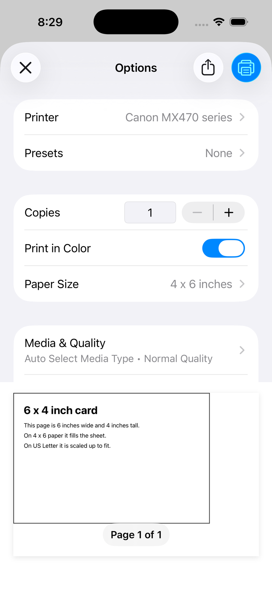
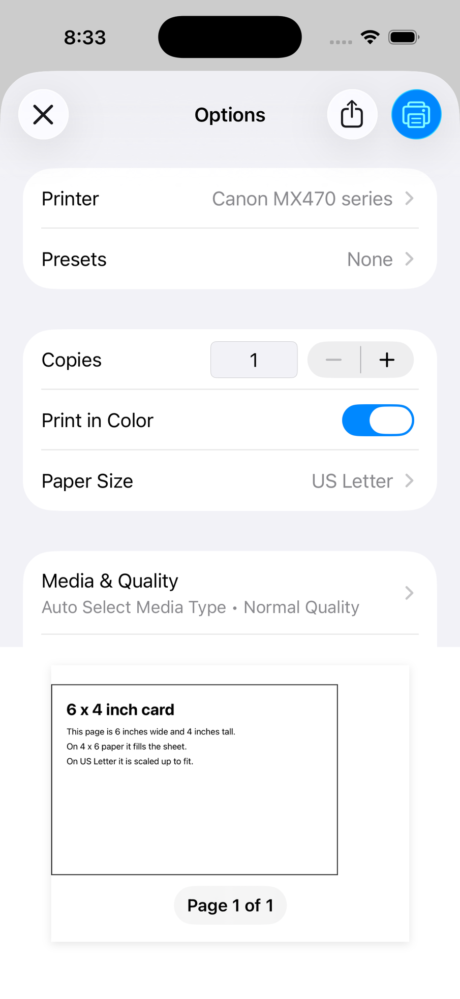

# expo-print preferredPaperSize repro

On iOS, `Print.printAsync` lets UIKit pick the paper. UIKit picks the printer's default paper, usually US Letter, and scales the page to fit it. A 6 x 4 inch card prints scaled up onto Letter, and the user has to pick 4 x 6 under Paper Size by hand on every print.

The proposed change adds an opt-in `preferredPaperSize: { width, height }` option, in points. When the user selects a printer, the print dialog preselects that printer's paper that best fits the size, such as 4 x 6 inches. With `printerUrl`, the job prints on that paper without the dialog.

Upstream PR: https://github.com/expo/expo/pull/53218

## Setup

- Expo SDK 58, `expo-print` 58.0.8.
- `patches/expo-print@58.0.8.patch` adds the option. `pnpm-workspace.yaml` applies it through `patchedDependencies`.
- `package.json` sets `expo.autolinking.ios.buildFromSource: ["ExpoPrint"]`. SDK 58 links Expo modules as prebuilt xcframeworks, which would ignore the patched Swift sources.

## Run it

```sh
pnpm install
npx expo run:ios
```

The screen has two sections.

**Print dialog.**

1. Tap a button. The print dialog opens.
2. Under Printer, select a printer that reports 4 x 6 paper. Xcode's Printer Simulator works, and so does a real printer.
3. Read the Paper Size row. Close the dialog without printing.

**No dialog (printerUrl).** These buttons send the job straight to the printer, so use a test printer unless you want real cards.

1. Tap Select printer and pick the printer.
2. Tap a print button, then read which paper the job asked for in the printer's log.

`tools/ippeveprinter.conf` describes a virtual printer that reports US Letter, A4, 4 x 6 and 5 x 7 paper, with US Letter as its default. Start it on the Mac that runs the simulator:

```sh
ippeveprinter -vv -k -p 8631 -a tools/ippeveprinter.conf -r _print,_universal "Expo Print Test" 2> ippeveprinter.log
```

It shows up in the simulator as Expo Print Test. Each job's `Validate-Job` request carries the paper in `media-col`, for example `media-size={x-dimension=10160 y-dimension=15240}` for 4 x 6 inches. The `ippeveprinter` that ships with macOS (CUPS 2.3.4) then rejects the job's `Create-Job` request, so nothing prints, and iOS keeps retrying the job. The size is still in the log. Test one button at a time, because iOS sends queued jobs in order.

## What to expect

| Button                                       | Paper                 |
| -------------------------------------------- | --------------------- |
| Print 4x6 (default)                          | US Letter             |
| Print 4x6 with preferredPaperSize            | 4 x 6 inches          |
| Print 4x6 to printer (default)               | the printer's default |
| Print 4x6 to printer with preferredPaperSize | 4 x 6 inches          |

With Expo Print Test, the two `printerUrl` buttons ask for 21590 x 27940 (US Letter) and 10160 x 15240 (4 x 6 inches), in hundredths of a millimetre.

To see today's behaviour, delete the `expo-print` entry from `pnpm-workspace.yaml`, then run `pnpm install`, `npx expo prebuild --clean` and `npx expo run:ios`. Each pair of buttons then gives the same paper, US Letter in the dialog and the printer's default with `printerUrl`. The clean prebuild matters, because `ios/Podfile.lock` still points at the patched package. TypeScript then flags `preferredPaperSize` and `Print.PaperSize` in `App.tsx`, but Metro still bundles the app, and native code ignores the option.

## Screenshots

An iPhone 17 Pro simulator on iOS 26.5, with a Canon MX470 selected. The MX470 reports bordered 4 x 6 paper.

|                   | Print 4x6 (default)                      | Print 4x6 with preferredPaperSize           |
| ----------------- | ---------------------------------------- | ------------------------------------------- |
| With the patch    |    |  |
| Without the patch |  |   |
